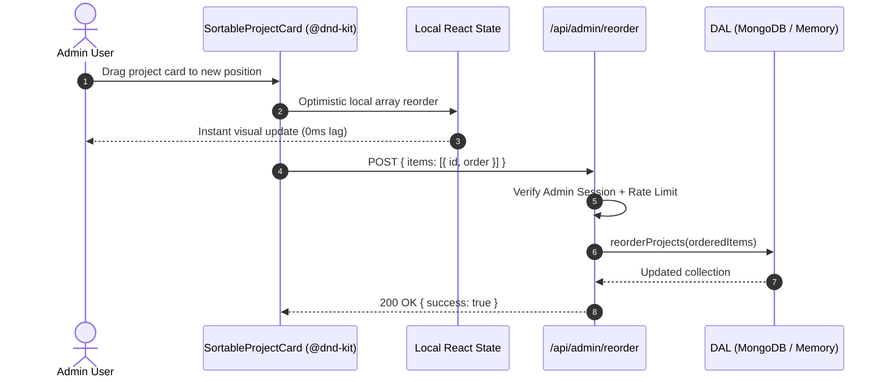

# Architecture & System Design — Shivam Jaiswal Portfolio & In-Place CMS

A comprehensive architecture specification detailing the system topology, component interactions, security model, and data flow of the Resfolio-style portfolio.

---

## 1. High-Level System Architecture

```mermaid
flowchart TD
    subgraph Client ["Client Tier"]
        Visitor["Public Visitor\n(Desktop / Mobile)"]
        AdminUser["Admin (@Shivam9621)\n(Authenticated Session)"]
    end

    subgraph CDN ["Edge & Routing Tier"]
        EdgeProxy["Edge / Reverse Proxy\n(Security Headers & CSP)"]
        Middleware["Next.js Proxy Middleware\n(Rate Limiter: 60 req/min\nAdmin Route Gate)"]
    end

    subgraph AppServer ["Application Tier (Next.js 16 App Router)"]
        subgraph ServerComponents ["React Server Components (RSC)"]
            PPR["Partial Prerendering Engine"]
            PublicTree["Public Page Tree\n(TopBar, Hero, Experience, Projects,\nSkills, Education, Coursework, Contact)"]
            AdminStream["Admin Bar Server Stream\n(Suspense + connection())"]
        end

        subgraph ClientComponents ["Interactive Client Islands"]
            DndKit["@dnd-kit Canvas\n(Project Card Reordering)"]
            DrawerForms["Drawer Forms (Slide-over Modals)\n(Profile, Project, Experience, Skills, Achievements)"]
        end

        subgraph APIRoutes ["Admin & Auth API Layer"]
            AuthRoute["/api/auth/[...nextauth]\n(GitHub OAuth + 1-Click Dev Admin)"]
            AdminCRUD["/api/admin/[entity]\n(POST / PATCH / DELETE)"]
            ReorderAPI["/api/admin/reorder\n(Atomic Index Updates)"]
            BackupAPI["/api/admin/backup\n(JSON Snapshot Exporter)"]
        end

        subgraph DAL ["Data Access Layer (DAL)"]
            ZodGuard["Zod Schema Validation\n(Runtime Type Invariants)"]
            DataHandlers["Data Handlers\n(addProject, updateProfile, etc.)"]
        end
    end

    subgraph Persistence ["Persistence Tier"]
        MongoCache["Mongoose Connection Pool\n(Global Cached Connection)"]
        MongoDB[("MongoDB Atlas\n(Production Remote Database)")]
        LocalSeed[("In-Memory Local Fallback\n(Auto-Seeded Zero-Config Fallback)")]
    end

    Visitor -->|GET / (Instant SSR/PPR)| EdgeProxy
    AdminUser -->|GET / + Session Cookie| EdgeProxy
    EdgeProxy --> Middleware
    Middleware --> ServerComponents
    ServerComponents --> PublicTree
    AdminStream -->|Admin Verified| ClientComponents
    ClientComponents -->|Mutations| AdminCRUD
    ClientComponents -->|Drag End| ReorderAPI
    AdminBarServer --> BackupAPI

    AdminCRUD --> DAL
    ReorderAPI --> DAL
    BackupAPI --> DAL
    DAL --> ZodGuard
    ZodGuard --> DataHandlers

    DataHandlers --> MongoCache
    MongoCache -->|URI configured| MongoDB
    MongoCache -->|URI absent / offline| LocalSeed
```

---

## 2. Request & Execution Lifecycle

### A. Public Visitor (Read Path)
1. **Edge Request:** Visitor requests `GET /`.
2. **Security Headers:** Response headers are injected by Next.js configuration:
   - `Content-Security-Policy`: Restricts scripts, styles, fonts, and embeds.
   - `X-Frame-Options: DENY`, `X-Content-Type-Options: nosniff`.
3. **Partial Prerendering (PPR):**
   - The shell, Hero, Experience, Projects, Skills, Education, Coursework, and Contact sections are served near-instantly from prerendered cache.
   - `AdminBarServer` is wrapped in `<Suspense fallback={null}>`. Since the visitor has no admin session cookie, `AdminBarServer` resolves to `null`.
   - **Zero Overhead:** No admin bundle code, `@dnd-kit` bundle, or editing modals are downloaded to the visitor's browser.

### B. Admin Mutation (Write Path)
1. **Interactive Edit:** Admin toggles "Edit Mode" in the pinned top bar and clicks "Edit" on a section.
2. **Slide-Over Drawer:** The client drawer loads dynamically with prefilled entity fields.
3. **Client Submission:** Form data is submitted via `fetch()` to `/api/admin/*`.
4. **Middleware Protection:**
   - Client IP is checked against the **In-Memory Sliding-Window Rate Limiter** (`rateLimit(ip, 60, 60_000)`). If exceeded, HTTP `429 Too Many Requests` is returned with `Retry-After` headers.
   - `req.auth` session is verified. If unauthenticated or `!session.isAdmin`, HTTP `401 Unauthorized` is returned immediately.
5. **Route Validation:** The route handler invokes `requireAdmin()` and validates the payload with strict **Zod schemas**.
6. **Data Persistence:**
   - If `MONGODB_URI` is provided, Mongoose connects and executes the update on MongoDB Atlas.
   - If running locally without credentials, the DAL updates the in-memory fallback store and logs the update.
7. **Cache Invalidation:** `revalidatePath("/")` purges the server cache, ensuring real-time consistency on subsequent requests.

---

## 3. Security Architecture & Boundary Layers

| Security Layer | Implementation | Defense Strategy |
|---|---|---|
| **Network & Transport** | HTTPS, HSTS, Secure Cookies | Prevents MitM attacks and eavesdropping |
| **Edge Proxy** | Strict CSP, X-Frame-Options, Nosniff | Mitigates XSS, clickjacking, and MIME sniffing |
| **API Gate / Middleware** | Sliding Window Rate Limiter (60 req/min) | Prevents denial-of-service and brute force mutation abuse |
| **Identity & Access** | Auth.js v5 with strict username allowlist (`ADMIN_GITHUB_LOGIN=Shivam9621`) | Strict RBAC: only authorized GitHub user can assume admin rights |
| **Runtime Data Validation** | Zod Schemas (`ProjectSchema`, `ProfileSchema`, etc.) | Prevents prototype pollution, unexpected keys, and invalid formats |
| **Bundle Isolation** | Dynamic imports via `next/dynamic` | Admin code and dependencies never leak into public client bundles |

---

## 4. Drag & Drop Reordering Architecture



---

## 5. Deployment Topology

The application is container-ready and supports dual deployment models:

### Model A: Google Cloud Run (Containerized Microservice)
- Multi-stage `Dockerfile` compiles Next.js standalone server.
- Deployed on Google Cloud Run with automatic zero-to-N autoscaling.
- Managed SSL and Google global load balancing.

### Model B: Firebase App Hosting (Google's Native Next.js SSR Platform)
- Direct GitHub-backed continuous deployment.
- Seamless Secret Manager integration for `AUTH_SECRET`, `MONGODB_URI`, and GitHub OAuth.
- Backed by Google Cloud Build and Cloud Run with optimized caching.
