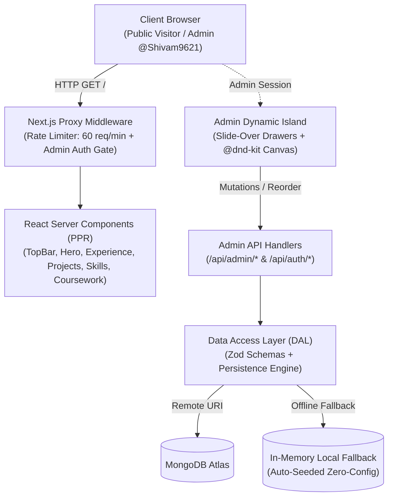

# Shivam Jaiswal — Resfolio-Style Personal Portfolio & In-Place CMS

A modern, high-performance developer portfolio built for **Shivam Jaiswal** (AI/ML Engineer), inspired by the futuristic, glassmorphic aesthetic of [Resfolio](https://abhivir.vercel.app/).

Engineered with **Next.js 16 App Router (Turbopack)**, **Tailwind CSS v4**, **Auth.js v5 (NextAuth)**, and **MongoDB / Mongoose** with an automatic offline seed fallback. Features live in-place admin editing, drag-and-drop project reordering, and instant JSON backup.

---

## 🌟 Key Highlights & Features

- **Futuristic Resfolio Aesthetic:**
  - Deep dark background (`#050505`) with ambient radial cyan and purple glow orbs.
  - Glassmorphic backdrop-blur cards with micro-borders and subtle hover elevations.
  - Clean English typography using `Geist Sans` and `Geist Mono`.
  - Responsive layout optimized for mobile, tablet, and ultra-wide displays.

- **In-Place Admin Editing (Zero-Code Updates):**
  - Instant admin edit bar pinned to the top when signed in.
  - **Edit Mode Switch:** Reveals live edit buttons across all sections without leaving the page.
  - **Drag-and-Drop Reordering:** Reorder portfolio projects interactively with `@dnd-kit` touch and mouse sensors.
  - **Drawer Forms:** Slide-over modal forms to update:
    - **Profile & Bio:** Name, headline, summary bio, location, email, and social links (GitHub, LinkedIn, LeetCode, Resume link).
    - **Experience:** Company, role, period, and full bullet points (e.g. Siemens Technology).
    - **Projects:** Title, description, tags, GitHub URL, live demo URL, and featured status.
    - **Skills & Categories:** Programming languages, ML/DL frameworks, NLP, databases, and DevOps tools.
    - **Education, Achievements & Coursework:** CGPA, verified ratings (LeetCode 400+ solved / 1660 rating), and core CS coursework (DBMS, OS, DSA, Computer Networks, Machine Learning, AI).

- **Robust Security & Admin Protection:**
  - **Auth.js (NextAuth v5):** Admin session backed by GitHub OAuth allowlist (`ADMIN_GITHUB_LOGIN=Shivam9621`) and a 1-click Dev Admin provider for local testing.
  - **Admin API Protection:** Proxy middleware protects all `/api/admin/*` mutation routes, returning `401 Unauthorized` without a valid admin session.
  - **Rate Limiting:** Built-in sliding window rate limiter prevents brute-force or spam mutations (returns `429 Too Many Requests`).
  - **Security Headers:** Strict Content Security Policy (CSP), `X-Frame-Options: DENY`, `X-Content-Type-Options: nosniff`, and `Referrer-Policy`.
  - **Code Splitting & Privacy:** Admin drawer forms, `@dnd-kit` sorting libraries, and admin bars are dynamically imported only when an authenticated admin session is active. Standard visitors download 0 bytes of admin code.

- **Dual-Mode Persistence (Zero Setup Friction):**
  - **MongoDB Atlas:** Connects seamlessly via Mongoose when `MONGODB_URI` is provided.
  - **In-Memory Local Fallback:** When running offline or without database credentials, the portfolio automatically boots with complete pre-seeded data, allowing full CRUD operations in memory.
  - **1-Click Backup:** One-click export button in the Admin Bar downloads the entire portfolio dataset as a timestamped JSON file (`shivam-portfolio-backup.json`).

- **SEO & Performance:**
  - Dynamic OpenGraph card generation (`/opengraph-image`).
  - Automated `sitemap.xml` and `robots.txt`.
  - Structured JSON-LD schema markup (`schema.org/Person`) for rich search engine indexing.
  - Next.js Partial Prerendering (PPR) for near-instant Time to First Byte (TTFB).

---

## 🏛️ System Architecture

For a comprehensive breakdown with sequence diagrams and lifecycle specifications, see [ARCHITECTURE.md](./ARCHITECTURE.md).



---

## 🚀 Tech Stack

| Layer | Technology |
|---|---|
| **Framework** | Next.js 16.4 (App Router, Turbopack, Partial Prefetching) |
| **Styling** | Tailwind CSS v4, `@tailwindcss/postcss` |
| **Icons** | Lucide React + custom SVG brand icons |
| **Authentication** | Auth.js v5 (`next-auth@beta`) |
| **Drag & Drop** | `@dnd-kit/core`, `@dnd-kit/sortable`, `@dnd-kit/utilities` |
| **Database** | MongoDB Atlas with Mongoose (with local in-memory fallback) |
| **Validation** | Zod schemas for all models |
| **Font** | `Geist` & `Geist Mono` |

---

## 🛠️ Getting Started

### 1. Clone & Install Dependencies

```bash
git clone https://github.com/Shivam9621/Shivam-Portfolio.git
cd "Shivam Portfolio"
npm install
```

### 2. Configure Environment Variables

Create a `.env.local` file in the root directory:

```env
# Auth.js Secret (generate via: openssl rand -base64 32)
AUTH_SECRET=your_auth_secret_here
NEXTAUTH_SECRET=your_auth_secret_here
NEXTAUTH_URL=http://localhost:3000

# Admin GitHub Username
ADMIN_GITHUB_LOGIN=Shivam9621

# Optional: GitHub OAuth App (for production OAuth sign-in)
# Register at: https://github.com/settings/developers
# Callback URL: http://localhost:3000/api/auth/callback/github
GITHUB_ID=
GITHUB_SECRET=

# Optional: MongoDB Atlas Connection String
# If omitted, portfolio seamlessly runs using the local seed data in memory!
MONGODB_URI=
```

### 3. Run Development Server

```bash
npm run dev
```

Open [http://localhost:3000](http://localhost:3000) in your browser.

---

## 🔐 How to Use Admin Mode

1. Navigate to [http://localhost:3000/admin/signin](http://localhost:3000/admin/signin).
2. Click **Instant 1-Click Admin Sign-In** (or sign in via GitHub OAuth if credentials are configured).
3. Once authenticated, you will be redirected to the homepage where the glowing **Admin Bar** appears at the top.
4. Toggle **"Edit Mode"** to active:
   - Hover over any section to reveal the **"Edit"** or **"+ Add"** buttons.
   - Reorder projects simply by dragging cards around.
   - Click any **Edit** button to open the slide-over drawer form, update details, and click **Save Changes**. The page revalidates and reflects changes immediately.
5. Click **"Backup JSON"** anytime to download a snapshot of all portfolio contents.

---

## 📦 Production Build & Deployment

### Build Locally

```bash
npm run build
npm run start
```

### Deploy to Vercel

1. Push your repository to GitHub.
2. Import the project into [Vercel](https://vercel.com).
3. In Vercel Project Settings &rarr; **Environment Variables**, configure:
   - `AUTH_SECRET` (generate using `npx auth secret`)
   - `ADMIN_GITHUB_LOGIN` (e.g. `Shivam9621`)
   - `GITHUB_ID` & `GITHUB_SECRET` (from GitHub Developer Settings)
   - `MONGODB_URI` (from MongoDB Atlas)
4. Click **Deploy**. Vercel will build and launch your portfolio with serverless edge rendering.

---

## 📄 License

MIT © [Shivam Jaiswal](https://github.com/Shivam9621)
